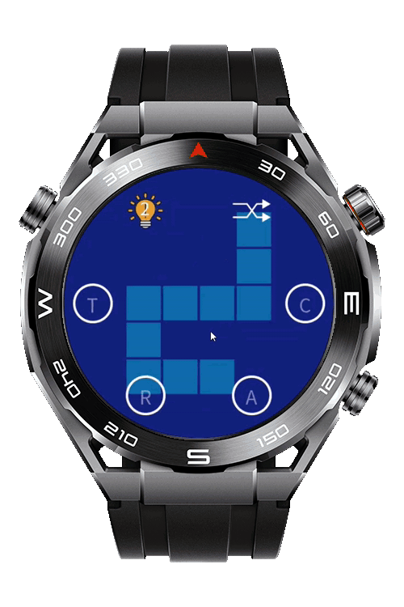
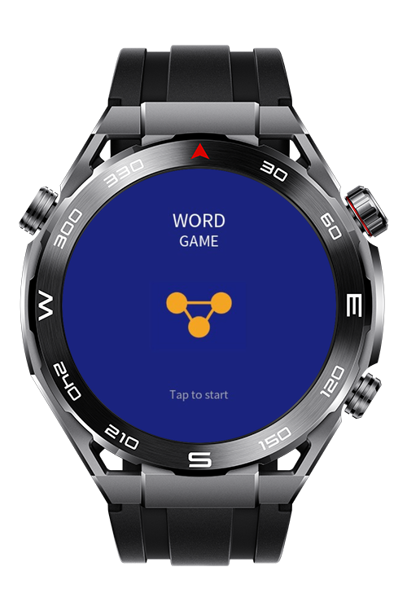
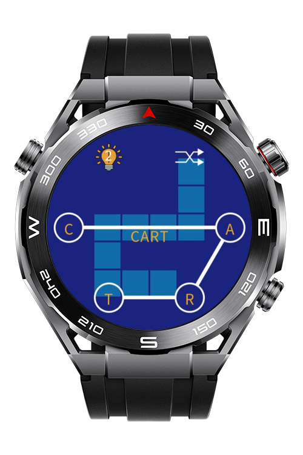
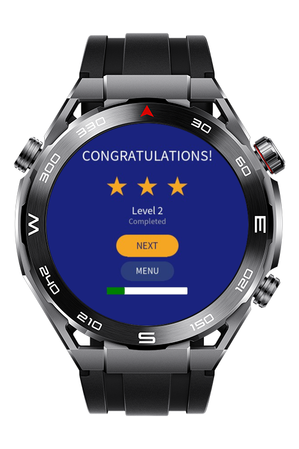

> **Note:** To access all shared projects, get information about environment setup, and view other guides, please visit [Explore-In-HMOS Index](https://github.com/Explore-In-HMOS/hmos-index).

# Word Game Sport Watch

A game where you solve a series of crosswords by selecting from an array of letters laid out in a radial pattern.

The crossword grid and the letter selection ui is rendered using the 2d canvas component.

# Preview

<div>
    
    
    
    
</div>

# Use Cases

- **Crossword Puzzle Gameplay:** Solve a series of crosswords with increasing difficulty
- **Level Transition:** Display level and congratulations message after completing each puzzle
- **Use Hints:** The player may reveal a letter by using a hint
- **Shuffle Letters:** The letters can be shuffled to make it easier to drag or see a word
- **Game Over:** A restart option appears upon completion allowing the player to start from level one

# Tech Stack

- **Languages:** javascript / HML
- **FrameWorks:** HarmonyOS 6.0.2 Release SDK
- **Tools:** DevEco Studio 6.0.2 Release
- **Libraries:**
    - `Canvas`
    - `CanvasRenderingContext2D`

# Directory Structure

```
└───entry
    │   .gitignore
    │   build-profile.json5
    │   hvigorfile.ts
    │   oh-package.json5
    │
    └───src
        └───main
            │   config.json
            │
            ├───js
            │   └───MainAbility
            │       │   app.js
            │       │
            │       ├───common
            │       │   ├───assets
            │       │   │       hint_button.png
            │       │   │       logo.png
            │       │   │       mix_button.png
            │       │   │
            │       │   ├───settings
            │       │   │       app-colors.js
            │       │   │       app-sizes.js
            │       │   │       canvas-settings.js
            │       │   │
            │       │   └───style
            │       │           base.css
            │       │
            │       ├───i18n
            │       │       en-US.json
            │       │
            │       ├───lib
            │       │       controller.js
            │       │       grid.js
            │       │       level.js
            │       │       renderer.js
            │       │
            │       └───pages
            │           ├───game
            │           │       game.css
            │           │       game.hml
            │           │       game.js
            │           │
            │           ├───index
            │           │       index.css
            │           │       index.hml
            │           │       index.js
            │           │
            │           └───win
            │                   win.css
            │                   win.hml
            │                   win.js
            │
            └───resources
                └───base
                    ├───element
                    │       string.json
                    │
                    └───media
                            icon.png
                            icon_small.png
                
```

# Constraints and Restrictions

## Supported Devices

- Huawei Sport (Lite) Watch GT 4/5/6
- Huawei Sport (Lite) GT4/5 Pro
- Huawei Sport (Lite) Fit 3/4
- Huawei Sport (Lite) D2
- Huawei Sport (Lite) Ultimate

# License

**Word game sport watch** is distributed under the MIT License.

See [LICENSE](./LICENSE) for more information.